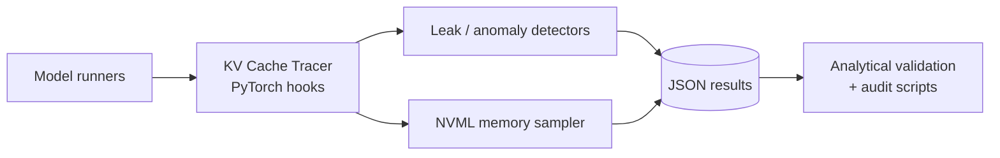

# KVScope: Cross-Architecture KV Cache Profiling

Measures how the KV cache grows during LLM inference across different attention
designs: pure MHA, GQA, local/global and sliding/full hybrids, MoE, and
SSM/DeltaNet hybrids.

Results come from two runs, each archived on Zenodo as a self-authored preprint
(not peer-reviewed):

- **V1**: NVIDIA H100 80GB, April 2026, [10.5281/zenodo.19871039](https://doi.org/10.5281/zenodo.19871039)
- **V2**: NVIDIA H200, May 2026, [10.5281/zenodo.20445398](https://doi.org/10.5281/zenodo.20445398)

---

## What it does

KVScope attaches PyTorch forward hooks to a HuggingFace model's attention
layers. At each decode step it records the K and V tensor shapes, sizes and
dtypes per layer, and it samples GPU memory through NVML. Statistical detectors
then analyse the captured snapshots.



### Models with results

| Model | KV cache design |
|---|---|
| Pythia-1.4B | Pure MHA (num_kv_heads == num_attention_heads). The baseline. |
| Gemma 4 | GQA with interleaved local (sliding-window) and global layers |
| GLM-4.7-Flash | MoE with DeepSeek Sparse Attention (V1 only) |
| gpt-oss-120B | GQA, alternating sliding-window and full-attention layers, MoE FFN |
| Qwen 3.6 | Gated DeltaNet layers + GQA attention layers (V2 only) |
| Nemotron-H | Mamba SSM + attention; profiled with `use_cache=False`, memory only (V2) |
| Llama-3.1-70B + Llama-3.2-1B | Speculative decoding, memory only (V2) |

---

## Components

### `src/profiler/kv_tracer.py`
Forward hooks that capture K/V tensor shapes, bytes and dtypes per layer per
decode step, plus `NVMLSampler` for driver-level GPU memory
(`device_idx="all"` sums across GPUs). A per-architecture layer classifier
decides which modules to hook. Classifiers exist for more architectures than
have results (DeepSeek MLA, DeepSeek V4, LFM2.5, Llama, MiniMax M3). Those
have not been run on real weights.

### `src/profiler/leak_detector.py`
Seven detectors, run by `KVLeakDetector`:

| Detector | What it checks |
|---|---|
| `GrowthCurveDetector` | Linear regression of KV size vs decode step; flags super-linear growth |
| `PostEOSDetector` | NVML memory before vs after generation; flags memory not released |
| `FragmentationDetector` | Gap between PyTorch `reserved` and `allocated` memory |
| `LayerAnomalyDetector` | Z-score outliers in per-layer cache size |
| `MLACompressionDriftDetector` | Drift in the MLA latent compression ratio (DeepSeek MLA) |
| `CacheDensityDetector` | Bytes per token per layer at peak |
| `LayerUniformityDetector` | Coefficient of variation of per-layer KV bytes |

### `src/profiler/triton_ops.py`
Triton GPU kernels for per-head L2 norms, the MLA Frobenius compression ratio
and attention entropy, each with a pure-PyTorch fallback.

### `src/profiler/adapters.py` and `kvscope` CLI
A registry with one entry per architecture: KV strategy, model ids and an
analytical KB/token/layer formula. A unit test keeps it in sync with the tracer's
classifiers.

```bash
kvscope list                 # all registered architectures
kvscope info gptoss          # details for one architecture
```

`kvscope info` currently prints an example density computed from placeholder
config values (8 KV heads, head_dim 128), not the model's real config.

### `src/api/`: black-box API profiler
Profiles a model through any OpenAI-compatible endpoint: time-to-first-token
vs input length, inter-token latency vs context length, and
needle-in-a-haystack recall. **Status: implemented and unit-tested; not yet run
against a live endpoint. No results are in this repository.**

```bash
export KVSCOPE_API_KEY=...
kvscope api --provider openrouter --model <model> \
  latency --lengths 1000,4000,16000 -o results/api/latency.json
```

### `src/models/minimax_m3_runner.py` and `experiments/vllm_comparison/`
An in-process runner for MiniMax M3, with a `--standin` flag for MiniMax-M2,
since M3 weights were not public when this was written (May 2026). There is
also a harness that serves a model with vLLM and scrapes its KV-cache usage
gauge. **Status: implemented; unit tests cover helpers only. Neither has been
run on real weights, and the M3 layer classifier has not been checked against
the released modeling code.** GPU provisioning notes are in
`docs/ibm_cloud_gpu_setup.md`.

---

## Model coverage

| Model | H100 V1 | H200 V2 |
|---|---|---|
| Pythia-1.4B | Profiled | Profiled |
| Gemma 4 | Profiled | Profiled |
| GLM-4.7-Flash | Profiled | Not profiled (failed to load) |
| gpt-oss-120B | Profiled | Profiled |
| Qwen 3.6 | - | Profiled |
| Nemotron-H | - | Memory only (no KV captured) |
| Speculative decoding (70B + 1B) | - | Memory only, 8 of 20 prompts |
| LFM2.5-350M | Failed | No profile file (see note) |
| DeepSeek V4, MiniMax M3 | - | Not run |

**Note on LFM2.5:** `results/h200_v2/comparative_analysis.json` contains an
`lfm25` entry, but there is no LFM2.5 profile file behind it and its origin is
unknown. It is excluded from every number in this README.

---

## Results

### H100 V1 (2026-04-27)
*NVIDIA H100 80GB HBM3, driver 590.48.01, CUDA 13.1. Source:
`results/h100_v1/comparative_analysis.json`, `results/h100_v1/perplexity.json`.*

| Model | KB/tok/layer | Layer CV | Peak overhead (MB) | Tok/s | WikiText-103 PPL | Max leak score |
|---|---:|---:|---:|---:|---:|---:|
| Pythia-1.4B | 8.00 | 0.000 | 98 | 87.1 | 12.43 | 0.335 |
| Gemma 4 | 14.67 | 0.203 | 8610 | 5055.4 | 827.71 | 0.212 |
| GLM-4.7-Flash | - | - | 417 | 15.1 | 15.29 | 0.329 |
| gpt-oss-120B | 2.00 ¹ | 0.935 | 57 | 14.9 | 317.66 | 0.241 |

¹ Full-attention layers only (mean 8086.4 KB per layer at a mean peak of 4043
tokens). Sliding-window layers hold about 254 KB each.

### H200 V2 (2026-05-23)
*NVIDIA H200, 143,771 MiB. 20 prompts (15 diverse + 5 stress tests). Source:
`results/h200_v2/*_profile.json`, aggregated by `scripts/final_paper_metrics.py`.*

| Model | KB/tok/layer | Layer CV | Layers with KV | Valid prompts |
|---|---:|---:|---:|---:|
| Pythia-1.4B | 8.00 | 0.000 | 24 | 20/20 |
| Gemma 4 | 14.67 | 0.203 | 60 | 20/20 |
| Qwen 3.6 | 2.00 | 0.000 | 10 | 20/20 |
| gpt-oss-120B | 1.12 ² | 0.902 | 36 | 20/20 |

² Averaged over all 36 layers, so it is not comparable to the V1 full-layer
figure. It also divides by *generated* tokens only (2,048), while the cache
also holds the prompt. Dividing by the full sequence length (about 2,150
tokens) gives 1.06. The other rows use the full sequence length.

On the first prompt, a gpt-oss full-attention layer holds 4.211 MB and a
sliding layer 0.248 MB: 80.3 MB in use against 151.6 MB if every layer were
allocated the full-layer size. That is 47% unused at that sequence length. Since
the unused fraction is ½ × (1 − window / seq_len) with a 128-token window, it
should approach 50% at long context (derived, not measured).

Nemotron-H and speculative decoding have NVML memory readings only; no
per-layer KV was captured.

`scripts/audit_paper.py` recomputes these numbers from the raw JSON and checks
them against the values quoted in the V2 report.

---

## Quick start

### Prerequisites
- NVIDIA GPU with 80 GB+ VRAM (H100/A100/H200) for the large models
- HuggingFace account with access to gated models
- About 50 GB of disk for weights and 2 GB for results

```bash
git clone https://github.com/CosmicAlgo/kvscope.git
cd kvscope
pip install -r requirements.txt
export HF_TOKEN=hf_your_token

# One model at a time (these have results in results/):
bash experiments/run_profiling.sh mha_baseline
bash experiments/run_profiling.sh gemma4
bash experiments/run_profiling.sh glm47flash
bash experiments/run_profiling.sh gptoss
bash experiments/run_profiling.sh qwen36
bash experiments/run_profiling.sh nemotron
bash experiments/run_spec_decode.sh

# Several in sequence (pass MODELS explicitly):
MODELS="mha_baseline gemma4 gptoss" bash experiments/run_full_collection.sh
```

## Tests

```bash
pip install pytest && pytest -q     # unit tests; no GPU or weights needed
```

CI (`.github/workflows/ci.yml`) runs ruff and the unit tests on Python 3.10
and 3.11 with CPU-only PyTorch. GPU code paths are not covered by CI.

---

## Project structure

```
kvscope/
├── .github/
│   └── workflows/
│       └── ci.yml                     # lint + unit tests
├── src/
│   ├── cli.py                         # `kvscope` entry point
│   ├── profiler/
│   │   ├── kv_tracer.py               # PyTorch hooks, NVML sampler
│   │   ├── leak_detector.py           # 7 detectors
│   │   ├── adapters.py                # architecture registry + analytical density
│   │   ├── triton_ops.py              # Triton kernels with PyTorch fallbacks
│   │   ├── compat.py                  # HF / PyTorch compatibility shims
│   │   └── json_utils.py              # safe JSON serialisation
│   ├── models/
│   │   ├── mha_baseline_runner.py     # Pythia-1.4B
│   │   ├── gemma4_runner.py
│   │   ├── glm47flash_runner.py
│   │   ├── qwen36_runner.py
│   │   ├── nemotron_runner.py
│   │   ├── lfm25_runner.py
│   │   ├── llama_runner.py
│   │   ├── spec_decode_runner.py
│   │   └── minimax_m3_runner.py       # not yet run
│   └── api/                           # black-box API profiler (not yet run)
├── experiments/
│   ├── configs/
│   │   ├── experiment_config.yaml
│   │   └── prompts_advanced.json
│   ├── run_profiling.sh               # per-model phases (gpt-oss is inline here)
│   ├── run_full_collection.sh
│   ├── run_longctx_sweep.sh
│   ├── run_spec_decode.sh
│   └── vllm_comparison/               # vLLM serving harness (not yet run)
├── scripts/
│   ├── analytical_validation.py
│   ├── final_paper_metrics.py         # V2 aggregate table
│   └── audit_paper.py                 # recompute report numbers from raw JSON
├── results/
│   ├── h100_v1/
│   └── h200_v2/
├── results_local/
│   └── longctx_sweep_pythia.json
├── docs/
│   └── ibm_cloud_gpu_setup.md
├── tests/
├── requirements.txt
├── pyproject.toml
└── LICENSE
```

`scripts/` contains further one-off analysis scripts not listed here.

---

## Methodology notes

### MHA baseline
Every run includes `EleutherAI/pythia-1.4b-deduped`: 24 layers, 16 attention
heads, head_dim 128, num_kv_heads == num_attention_heads. KV per token per
layer in bf16 = 16 × 128 × 2 (K and V) × 2 bytes = 8,192 B = 8.00 KB, which
matches the measured value. Other models' densities are compared against this
baseline.

### Perplexity
WikiText-103 test split, sliding window (context 1024, stride 512, 64 chunks),
computed by `scripts/perplexity_local.py`.

### Sequence-length scaling
Per-step wall times are recorded by `KVCacheTracer.report()` under
`decode_timing.step_wall_times_ms`.

---

## References

- Kwon et al., 2023. [Efficient Memory Management for LLM Serving with PagedAttention](https://arxiv.org/abs/2309.06180)
- Ainslie et al., 2023. [GQA: Training Generalized Multi-Query Transformer Models from Multi-Head Checkpoints](https://arxiv.org/abs/2305.13245)
- Biderman et al., 2023. [Pythia: A Suite for Analyzing Large Language Models Across Training and Scaling](https://arxiv.org/abs/2304.01373)

---

## Citation

Surya, R. (2026). *KVScope: Profiling Cross-Architecture KV-Cache Dynamics on
NVIDIA H100* (Version 1.0.0) [Preprint]. Zenodo.
https://doi.org/10.5281/zenodo.19871039

Surya, R. (2026). *KVScope V2: Cross-Architecture KV-Cache Profiling on NVIDIA
H200* (Version 2.0.0) [Preprint]. Zenodo.
https://doi.org/10.5281/zenodo.20445398

---

## License

MIT

## Author

Rahul Surya, MSc HPC with Data Science, EPCC, University of Edinburgh
